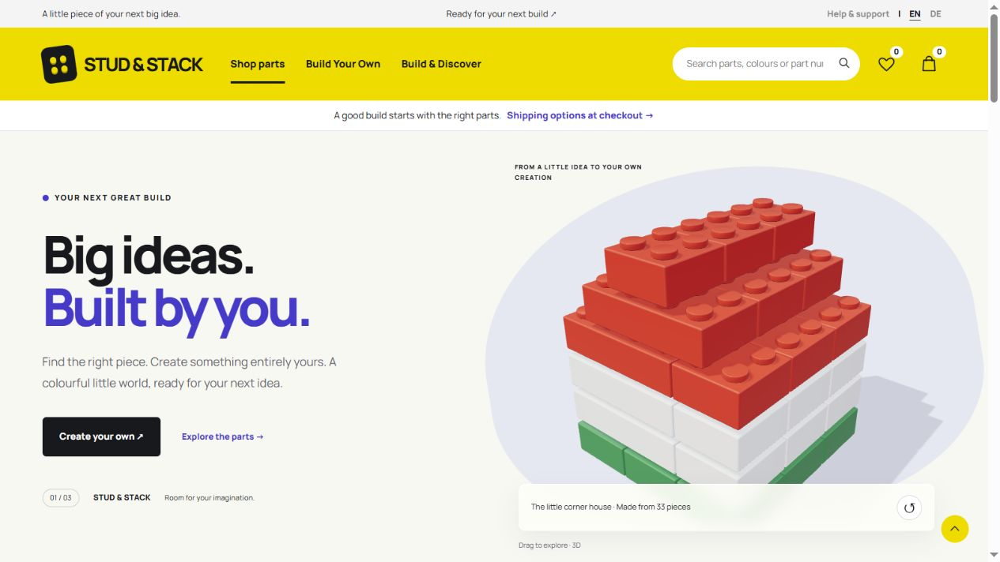

# Stud & Stack

A specialised parts storefront with a 3D building studio. Search individual pieces, compare colours and variants, build a model and carry its parts list into the shopping cart.



## Features

- Parts search with suggestions, category, colour, condition and price filters
- Product variants, quantity selection, wishlist and cart
- Interactive 3D home scene and a separate building workspace
- Grid snapping, placement previews, rotation, collision checks and a generated parts list
- Camera orbit, top view, zoom and view reset, with a 2D alternative
- Delivery, payment-choice, review and confirmation screens
- German and English interfaces
- Optional WordPress plugin using `[studstack_shop]`

## Run locally

Requires Node.js 20 or later. There are no packages to install.

```sh
npm start
```

Open **http://127.0.0.1:4168/**. Serve the files over HTTP: browser module loading does not work reliably through `file://`.

## Architecture

| File | Responsibility |
| --- | --- |
| `app.js` | Catalogue data, filtering, variants, cart and checkout state |
| `creative.js` | Building interactions and model data |
| `studio3d.js` | Three.js rendering, camera, models and placement feedback |
| `experience.js` | Storefront interaction enhancements |
| `vendor/three/` | Locally bundled Three.js and controls |
| `wordpress/studstack-parts-showcase/` | Installable WordPress variant |

Product prices use integer cents. Cart, wishlist and language are stored locally. Checkout is a browser workflow; live payments, orders, stock reservations and catalogue-provider integrations require separate server-side services. Large commercial inventories require server-side search and pagination.

## WordPress installation

Zip the `wordpress/studstack-parts-showcase` folder, upload it through **Plugins → Add Plugin → Upload Plugin**, then activate it. Add `[studstack_shop]` to a page. Configure the brand, accent colour and default language under **Settings → StudStack**.

Requires WordPress 6.0+ and PHP 7.4+. The shortcode page uses the standalone shop layout. Elementor and WooCommerce are not required.

## Development

```sh
npm run check
```

Keep the static source and WordPress frontend files in sync when changing shared behaviour. The 3D renderer uses locally bundled modules and needs WebGL 2. The SVG product artwork and 2D builder remain useful fallback views.

## Credits and licences

Designed and developed by **Steffen Riesberg · BAUVERIS**. Project code is distributed under GPL-2.0-or-later, as specified by the original project. Three.js is MIT licensed; its licence and version information are in `vendor/three/`. Manrope's SIL Open Font Licence is included with the font assets. Product graphics are project-created illustrations and renders.

[Project overview](https://bauveris.de/en/projects/shops/#stud-stack) · [Contact BAUVERIS](https://bauveris.de/en/contact/)
